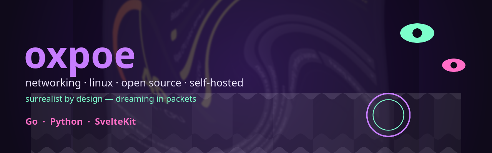

> 🪞 **Mirror.** Repo asli, pengembangan & **rilis/unduhan** ada di **Gitea**: https://gitea.oxpoe.qzz.io/oxpoe/oxpoe/releases · GitHub hanya cermin kode.

  
  
  
  
  
  

### 🌌 The dream

I like the places where **networks**, **Linux** and **self-hosting** blur into each other:
a packet takes a strange route home, a service that used to live in someone else's cloud
moves onto a box under the desk, a device that only spoke Windows learns a new language.

Surrealism is my way of thinking about systems — surprise, dream logic, and the freedom to
rearrange what everyone assumed was fixed.

### 🌀 What I get lost in

| | |
|---|---|
| **networking** | routing, tunnels, DNS, wire-format archaeology, watching packets drift |
| **self-hosted** | services that answer to nobody but their owner |
| **linux** | `hidraw`, `systemd`, `hwmon` — the small interfaces everything else stands on |
| **open source** | reading the code, fixing upstream, giving the fix back |

### 🛠 The stack I reach for

- **Go** — daemons, network plumbing, small binaries that stay small
- **Python** — protocol work and tooling; the honest little script that just works
- **SvelteKit** — light interfaces for the services I self-host

### ★ Featured project — GAMEMAX LCD

A cooler's LCD panel that only spoke to a Windows application. I reverse engineered the
panel's HID protocol from that app and rebuilt the useful half for Linux: a
dependency-free sender streaming the exact 65-byte report the firmware reads, plus an
animated tray app with fan/temperature pickers, systemd autostart and plug & play.

[**Repository**](https://gitea.oxpoe.qzz.io/oxpoe/Gamemax-linux-apps) ·
[**Releases**](https://gitea.oxpoe.qzz.io/oxpoe/Gamemax-linux-apps/releases) ·
[**Reverse-engineering notes**](https://gitea.oxpoe.qzz.io/oxpoe/Gamemax-linux-apps/src/branch/main/docs/reverse-engineering.md)

❤ If something I built saved you time, the dream runs on coffee:

